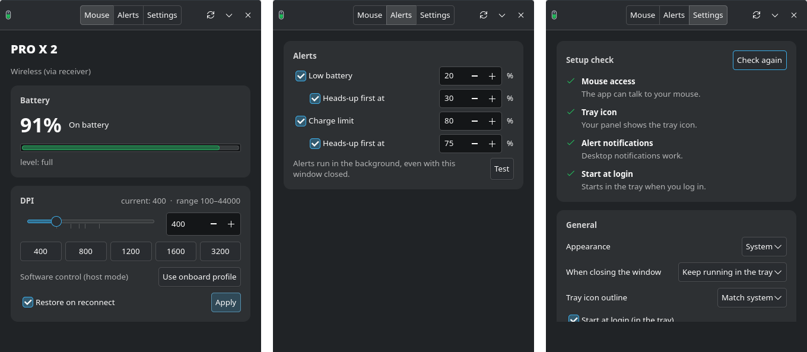

# G PRO Control: Logitech G PRO Wireless battery & DPI on Linux

**Check the battery and change the DPI of your Logitech G PRO Wireless, PRO X Superlight or PRO X Superlight 2 on Linux, without G HUB.** A small tray app for Arch Linux and Arch-based distros, on KDE Plasma, GNOME, Hyprland, Sway and others.



The tray icon is the mouse itself. It fills with the battery level and changes colour with its state: green, amber, red when low, blue with a bolt while charging.


## Why

Logitech G HUB doesn't run on Linux, so there's no official way to see how much charge your G PRO mouse has left, get warned before it dies, or change its DPI. G PRO Control does that directly over Logitech's HID++ protocol, through the LIGHTSPEED receiver or the USB cable.

If you searched for any of these, this is for you:

- How do I check my Logitech G PRO Wireless / Superlight battery percentage on Linux?
- How do I change DPI on a Logitech mouse on Linux without G HUB?
- A Logitech G HUB alternative for Linux / Arch Linux
- Low battery notification for a wireless mouse on Linux
- How do I stop overcharging my mouse (charge limit reminder)?

## Features

- battery percentage and charging state (charging / on battery / full), as reported by the mouse
- change DPI (slider, exact value, or presets), optionally re-applied when the mouse reconnects
- battery alerts as desktop notifications, each with an optional heads-up before it:
  - **Low battery**: on battery and the level drops to X% (default 20%, heads-up at 30%)
  - **Charge limit**: charging and the level reaches X% (default 80%, heads-up at 75%), so you can unplug
- lives in the system tray: the icon is a mouse whose fill height is the battery percentage and whose colour is the state (green, amber below 50%, red below 20%, blue with a lightning bolt while charging). The same mouse is the app icon in the menu and taskbar, the tooltip shows battery and DPI, and left-click shows or hides the window
- setup check (Settings page): looks at your desktop and fixes what's missing with one click each: adds the tray to Waybar, installs and enables GNOME's AppIndicator extension, installs a notification daemon (dunst), adds the startup line to Hyprland/Sway/i3/niri/river/Wayfire, or installs the mouse permission rule. Config files get a timestamped backup first. It opens by itself the first time something is missing on a desktop
- settings: appearance (System / Light / Dark, for this window only), what closing the window does (keep running in the tray, or quit), tray icon outline, and start at login

## Supported mice

| Mouse | Status |
|---|---|
| PRO X Superlight 2 / "PRO X 2" (HERO 2, up to 44000 DPI) | Tested, wired and wireless |
| G PRO Wireless | Should work (same HID++ battery and DPI features) |
| PRO X Superlight | Should work |
| Other Logitech HID++ 2.0 mice | Battery and DPI usually work; not tested |

Tried it on another mouse? Open an issue with the output of `gpro-control features` and `gpro-control status`, and it can be added to the list.

It talks HID++ 2.0 directly over `/dev/hidraw*`, both over the USB cable and through the LIGHTSPEED receiver. Dependencies: `python`, `python-gobject`, `gtk4` and `librsvg` (to draw the icon), nothing else.

## Install (Arch)

```bash
git clone https://github.com/swylem/gpro-control.git
cd gpro-control
makepkg -si
```

This installs `/usr/bin/gpro-control`, a menu entry, a systemd user service for the alerts, and a udev rule that gives your logged-in user access to Logitech HID devices. After installing, unplug and replug the mouse or receiver once (or run `sudo udevadm trigger`).

## Compatibility

Works on any Arch-based distro (Arch, CachyOS, EndeavourOS, Manjaro, Garuda, ...) with any desktop or compositor, X11 or Wayland. The window and mouse control work everywhere. The extras depend on what your desktop provides. Settings → **Setup check** detects what's missing and offers a one-click fix, and without a fix the app still degrades gracefully:

| Feature | Needs | Without it |
|---|---|---|
| Tray icon | A StatusNotifierItem tray: KDE, XFCE, LXQt, Cinnamon, Waybar's `tray` module, GNOME with the AppIndicator extension | Setup check adds the tray to Waybar or enables GNOME's extension; otherwise closing the window quits the app |
| Alert popups | A notification daemon: built into full desktops; `mako`, `dunst` or `swaync` on window managers | Setup check installs `dunst`; Alerts → **Test** tells you if none is running |
| Background alerts | systemd user session (every systemd-based Arch distro) | Alerts run inside the app while it's open |
| Start at login | A desktop that runs XDG autostart | Setup check adds the startup line to your Hyprland, Sway, i3, niri, river or Wayfire config |
| Tray icon light/dark | `xdg-desktop-portal` | Assumes a dark bar; Settings → **Tray icon outline** lets you pick White or Black |

Non-systemd Arch derivatives (e.g. Artix) are untested. The udev permission rule uses logind's `uaccess` tag, and the background alerts need systemd, so expect alerts to run only while the app is open there.

## Run from source

```bash
sudo install -Dm644 60-gpro-control.rules /usr/lib/udev/rules.d/60-gpro-control.rules
sudo udevadm control --reload && sudo udevadm trigger
./gpro-control
```

Without the udev rule the app still shows the battery (it reads it from the kernel's `hidpp_battery_*` node), but it can't change DPI.

## CLI

```
gpro-control --hidden      # start in the tray without opening the window
gpro-control status        # battery + DPI
gpro-control dpi 1600      # set DPI
gpro-control onboard       # hand DPI back to the mouse's onboard profile
gpro-control monitor       # run the alerts without a window
gpro-control features      # list HID++ features (debugging)
```

## Related tools

- [Solaar](https://github.com/pwr-Solaar/Solaar) manages a wide range of Logitech devices and settings. G PRO Control does less on purpose: G PRO battery, DPI, alerts and a tray icon.
- [Piper](https://github.com/libratbag/piper) / libratbag configure gaming mouse profiles, buttons and lighting.

## Notes

- **Onboard profile vs host mode:** out of the box the mouse runs its onboard profile (the one G HUB edits), and in that mode it rejects DPI changes. When you apply a DPI, the app switches the mouse to host (software) mode. Polling rate is not affected. "Use onboard profile" (or `gpro-control onboard`) switches back and restores the profile's DPI.
- **DPI persistence:** after a power cycle the mouse may come back on its onboard profile. While the app is open, "Restore on reconnect" sets your DPI again.
- **Alerts run in the background.** When any alert is on, the app enables `gpro-control-monitor.service` (a systemd user service), which checks the battery every 30 seconds, even with the window closed. Turning every alert off disables it again. Each alert fires once, then re-arms when you plug in (low battery) or unplug (charge limit).
- **Why an alert and not a real charge limit?** The mouse handles charging in its own firmware, and HID++ has no command to stop charging at a set level. Desktop USB ports generally can't switch off their 5 V power from software either. So the charge limit is a reminder to unplug.
- **Tray:** closing the window keeps the app in the tray by default. Quit from the tray menu, with Settings → "Quit G PRO Control", or with Ctrl+Q. If no system tray is running, closing the window always quits, so the app is never left running with no way back in. The tray uses the StatusNotifierItem protocol: KDE Plasma supports it out of the box, and GNOME needs the AppIndicator extension.
- **Icon:** the mouse icon is original artwork drawn in `gpro_control/icons.py` and released under the same MIT license. It isn't affiliated with Logitech and doesn't use Logitech's logo.
